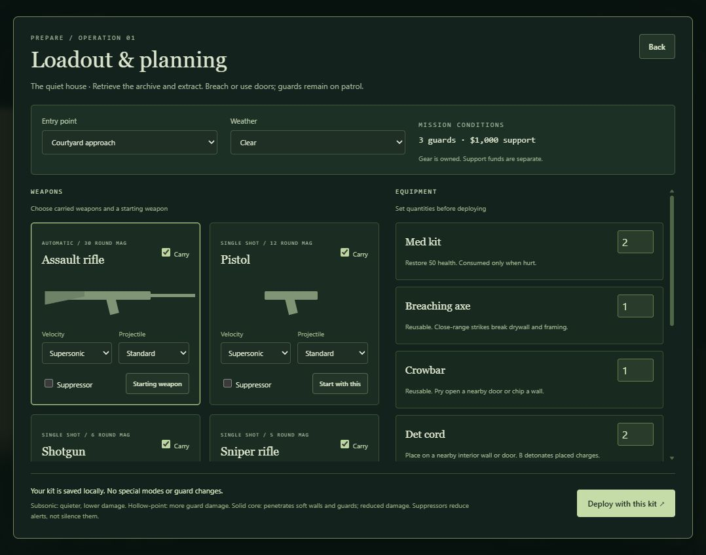

# Untitled stealth sandbox

A Three.js learning project: retrieve an archive from a small residence and escape, with first-person gunplay, an overhead view, and layered interior-wall destruction. The larger vision is a configurable planning and execution sandbox. The public name is undecided; **Door Kickers is already an existing tactical game**.

Project reference: [technical stack](tech_stack.md), [lessons learned](lessons_learned.md), and [design direction](docs/DESIGN.md).



## Run it

Install Node.js 22.12+ (Node 24 works), then open a terminal in this folder:

```sh
npm install
npm run dev -- --port 5179 --strictPort
```

Open http://127.0.0.1:5179. Use a desktop keyboard and a WebGL2-capable browser. This prototype has no touch controls.

```sh
npm test
npm run build
```

The production build is in `dist/`. No backend, accounts, paid services, API keys, or AI connection are needed. The game makes no external network requests once served.

## Play

**Floorplan map:** choose **Loadout & planning → Map → Martelli House** to play the layout traced from the images in `references/`. Start outside on **Main**, descend the central return stairs to **Foundation**, retrieve the storage archive, and return to the front walk. **M** opens the map and **F** cycles floors. The photos guide the front approach and lakeside orientation; dimensions and furnishings are approximate. See [reference notes](references/README.md).

Player health is the large bordered panel at the bottom left, with a thick bar and a numeric value out of 100. It turns amber at 50 health and red at 25, with explicit low-health warnings.

- First person is the default. Click the aim button to capture the mouse; Escape releases it and pauses. Click the aim button again to resume. If capture is unavailable, hold right mouse and drag to look, or use IJKL.
- WASD / arrows: move relative to the first-person facing direction; overhead movement uses world axes.
- Shift: hold to run; release to walk. Running is disabled while the M134 minigun is equipped. Hold Ctrl to creep; C toggles crouching. Both override running and reduce detection, with creeping the stealthier choice.
- V: switch first person / overhead. M: open/close a top-down tactical map; the map pauses simulation and returns to your previous play view. On the map, use **Viewing floor** to select a story or **F · Next floor** to cycle floors (keyboard F also works).
- Left mouse: use the equipped weapon/item. Hold for automatic assault rifle or M134 fire; other weapons fire once per click. First person aims at the crosshair; overhead aims toward the cursor at eye height.
- Tab: open/close inventory (or loadout planning before deployment). E: open/close a nearby door or collect the archive. Shift+Tab remains available for backward keyboard focus navigation in menus.
- 1–5: equip assault rifle, pistol, shotgun, sniper rifle, M134 minigun respectively, if carried.
- H: holster to empty hands; press again to draw your last firearm.
- R: reload. Each weapon has a separate magazine, firing cadence, damage, and reload time. Reserve ammunition is unlimited; magazine consumption is configurable.
- Z, or right click while mouse is captured: toggle aim. The sniper has a scope; scroll while scoped adjusts 2×–8× zoom. Without mouse capture, right-drag still looks around; Z aims.
- **Q: take / leave cover. Hold X: peek; release X: duck back immediately.** Face a wall, crate, table or planter within 1.6 metres and press Q. Low cover allows popping up; near a tall wall's edge you lean around it. A cover banner shows whether you are hidden, peeking or blocked. Move closer to an edge if no safe peek is available. WASD, C or E leaves the stance. Tucked players cannot fire firearms. Walls and solid props provide protection through collision; flanking enemies and foliage concealment still leave you vulnerable. Map, inventory, pause, blur and lost mouse capture drop the peek. Cover does not grant damage immunity. The [player-cover preview](http://127.0.0.1:5179/scripts/player-cover-preview.html) demonstrates low and tall cover with the live camera and enemy AI.
- Left-click fires while aiming or scoped, including the first click before mouse capture succeeds. Head hits instantly eliminate a guard with every weapon, suppressor, velocity, and projectile choice. Body hits retain configured damage and wall obstruction still applies.
- Right and left mouse buttons are handled independently: keep right held while clicking left to fire a pistol or another single-shot weapon. Releasing right does not cancel held left-button rifle fire.
- B: detonate placed charges while the mission is running.
- Return to the green ring to extract.
- Mouse button 4: strike at close range with the equipped firearm. Space: jump. P: pause/resume. Changing browser focus automatically pauses.
- Scroll over the overhead scene: zoom.
- Intel pulse: open the map with **M**, then spend $250 from its controls to reveal every guard for ten mission seconds across all floors. Its timer pauses while the map is open; an active pulse cannot be purchased again until it expires.
- Sandbox rules: change the simulation live. Entry point, guard count, budget, and door durability require **New deployment**.
- Rules persist in browser storage, with validated JSON import/export for sharing.

Wall breaching is part of the regular retrieval mission, with guards on patrol. Deploy normally and enter through the courtyard door, then breach the pale partition dividing the West Gallery from the Archive. Alternatively, select **Sandbox rules → Entry point → west gallery → New deployment** to start beside that partition in the same mission; this changes only your starting position, not guards, ammo, or difficulty. Shoot a patch to strip its front drywall, expose timber, break the framing, and clear the rear drywall. Sweep the opening wider and lower to make a walkable breach. A hole at eye height allows sight and shots but leaves lower collision intact. After bullets, tools, or blasts break wall pieces, any pieces or clusters disconnected from the floor and solid structure take full damage and disappear. Side or top connections can still support a piece; corner-only contact does not. New deployment rebuilds all walls and resets guard health. The former Breach lab preset and launch buttons have been removed; its unchanged saved settings migrate back to Recommended on reload.

Every visible setting is connected to this prototype. In overhead/map views, normal guard visibility requires proximity and line of sight; live tracking reveals positions through walls, and patrol-route intel is independent. First-person guards use normal 3D wall occlusion; use the map for tracking intel. Floor-plan intel currently controls the reference grid and room labels; overhead geometry remains visible. Fog reduces guard sight to 60%, rain to 85%. Damage immunity prevents health loss without removing suspicion. Walking through walls still respects map boundaries. Gunfire alerts nearby living guards for five mission seconds, turning them toward the shot source. Once suspicion fills, guards with sight of the player fire back. Damage and self-damage from equipment are configurable.

## Loadout and equipment (0.3)

Choose **Day** or **Night** in **Loadout & planning → Time of day** before deploying. Electric fixtures light interior rooms. Daylight fades with distance from windows and is blocked by walls; sunny days add directional patches of sunlight through window openings. At night, window light is faint. Open **M → Cut building power** to extinguish all building electric lights for that deployment. Sunlight and battery-powered goggles continue working; a new deployment restores power. The tactical map remains readable during a blackout.

Darkness reduces guard detection range according to the player's local lighting, while nearby targets remain detectable. Your worn optics do not improve the guards' vision.

**Night vision goggles** and **Thermal goggles** are carried equipment with one worn vision slot. Select a starting device in planning, use their **Wear / Remove** inventory buttons, or press **N** for night vision and **T** for thermals. Activating one replaces the other while keeping your firearm and ammunition ready. Night vision amplifies dark areas in green; thermals show visible warm bodies against a cool environment, with ordinary wall occlusion. Goggles are reusable. The [lighting development preview](http://127.0.0.1:5179/scripts/lighting-preview.html) compares a window room and a windowless room under sun, night, power cuts and both optics. Lighting uses an architectural light-field approximation rather than full global illumination; structural light-field geometry is generated on scene creation.

### Guard communication and response

Guards now use articulated procedural bodies with separate head, chest, stomach, left/right arm, and left/right leg hit capsules. The visible pose drives firearm and melee targeting, including wounded guards on the ground. Damage and penetration retain their existing settings; headshots remain lethal.

When guards engage you, they face you, raise their arms and aim a visible pistol at your current eye height, including crouching and different floors. Arms stay raised between shots; recoil, muzzle flashes and tracers come from the held weapon. One wounded arm leaves the healthy arm firing alone. Losing sight, holstering, stun or incapacitation ends the aiming pose. The NPC reaction preview also has an **Aim / fire preview** toggle.

Mobile guards who survive a hit retreat toward nearby reachable cover, preferring solid protection over foliage. They crouch while hiding, occasionally rise or lean out to return fire, then duck back. Their exposed head, torso and arms remain hittable. Wounds increase shot spread, with greater damage and arm injuries worsening accuracy; missed shots no longer automatically damage the player. Planters offer visual concealment above their solid base, while walls and solid props stop incoming fire. Guards re-evaluate broken cover and newly seen threat positions. With no usable cover they retreat away; incapacitated chest/stomach casualties retain their downed behavior. New deployments clear wounds and cover state. See the [live wounded-cover development preview](http://127.0.0.1:5179/scripts/cover-preview.html) to watch the actual behavior, freeze a peek, or break its cover.

- A surviving leg hit causes a persistent limp and reduces movement to 48%; both legs injured reduce it to 25%.
- A surviving arm hit bends the wounded arm and brings the opposite hand across to support it. Firing slows from 0.8 to 1.8 seconds between shots; two wounded arms prevent firing.
- A surviving stomach hit drops the guard, who curls and rolls onto a side. A surviving chest hit drops the guard into a ragdoll. Both incapacitate for the rest of the deployment, without counting as kills; there is no recovery/bleeding system yet.
- A headshot immediately releases the joints into a gravity-driven limp collapse near the hit location. Any other lethal damage also produces a ragdoll. Surviving incapacitated guards remain damageable and discoverable by teammates.

Ragdolls use a fixed-step particle/joint solver with gravity, distance/bend constraints, contact friction, and collisions against remaining walls, floors, closed doors, intact glass, props, and map boundaries. They fall when floor support is destroyed. Pause freezes bodies; a new deployment clears injuries. This is a lightweight procedural foundation: bodies do not collide with each other or the player, and there are no production skinned models, directional joint limits, or recovery animations yet.

For development, open [NPC reaction preview](http://127.0.0.1:5179/scripts/npc-preview.html) while the Vite dev server is running. **Apply hits** compares healthy, leg, arm, stomach, chest, and head reactions; **Reset bodies** repeats it. The preview uses the same body solver and meshes as the mission.

**H holsters your held item into empty hands; H again draws your last firearm.** Inventory also has **Holster · empty hands**. Carried weapons alone do not count as brandished: guards react to the item currently in your hands. Firearms, melee tools, and explosives count as armed; a med kit or door picking gun does not.

Once a guard identifies you through normal sight and suspicion, it radios your observed location to all living guards. Guards pursue that last reported position, route around walls, open authorized doors, and use stairs between stories. Losing sight does not give them your live position: they search the reported area and eventually resume patrols. Gunfire draws nearby guards to investigate its source when gunshot alerts are enabled.

An armed player is pursued and fired on when visible through a clear line of sight. For an unarmed player, a nearby guard stops and initiates **detention**. Other guards approach the detaining guard at 45% of patrol speed. This prototype detention never freezes movement, ends the mission, or blocks inventory. Walk away or draw a weapon; a visible weapon immediately changes the response to armed pursuit. Hiding a weapon again changes the current response back to unarmed pursuit/detention.

Guards visually discover incapacitated teammates (including stunned guards) and damage to walls, floors, windows, and doors. Discoveries require visibility and trigger backup/investigation at that location, rather than revealing where the player is. A guard surviving damage immediately radios for backup even with gunshot-noise alerts disabled. Dead or stunned guards cannot transmit. Radio calls appear above the controls; a separate banner identifies active detention. Sight cones use red for pursuit, amber for detention, blue for gathering backup, and purple for investigation/search.

### Maps and penetration

Set **Enemies (0–8)** beside the map, entry point, and weather in loadout planning. The selected count applies when you deploy and is saved with the sandbox rules. The current maps each supply eight patrol routes.

**Meridian Lodge** adds two stories, twelve rooms plus stair halls, central and cross hallways, glass windows, locked doors, and an upstairs archive. Choose it in **Loadout & planning → Map**. **West stair hall · inside** starts beside the stairs; **Front approach · locked entry** starts outside. Walk up the west stairs, turn east along the north landing, and enter the upper central hall to reach the locked archive. F opens the tactical map and switches its displayed floor; M returns to play. The ordinary guard count is preserved, with guards distributed across stories.

**C toggles crouching. Ctrl holds creeping.** Both use the creep-speed setting. Crouching lowers the camera and collision body, allows low breaches, reduces suspicion gain to half of walking, and reduces detection range to 80%. Creeping reduces suspicion gain to a quarter of walking and range to 65%; you can creep while crouched. Running cannot override either posture. Standing is refused if there is not enough headroom.

Shoot a pane or strike it within reach with an axe or crowbar to shatter it. Grenades, flashbangs, and Molotovs can be thrown through intact glass: the pane shatters and the item keeps flying. Glass alone does not trigger the item's explosion, flash, or fire. Walls, closed doors, and the window sill/frame still obstruct throws. Intact glass permits vision, blocks character movement, and does not protect against blasts. After breaking a window, approach and press **E** to climb through the opening. Upper-story windows can lead to a fall. Windows and their actual wall openings exist on both floors.

Buildings now have physical ceiling panels, including roof caps and lower-floor ceilings with open stair shafts. They block sight, shots and body clearance, and can be breached. Ceiling panels hide in overhead/tactical cutaways so rooms remain visible. E selects the nearest visible door/window with a facing preference; window traversal checks lateral alignment, clearance above the sill, the entire vault path and a safe standing/crouched landing. Upper windows warn when the ground outside is lower. Martelli's stairwell window has no level landing and directs you to the nearby front door. The [Martelli window preview](http://127.0.0.1:5179/scripts/window-preview.html) lets you inspect each opening and the real ceilings. Its other 15 windows are checked in both directions, standing/crouched and slightly off center; level landings are also tested repeatedly with physics running.

Equip **Door picking gun** in Tab inventory, close inventory, aim at a nearby locked door, then left-click. This reusable placeholder immediately unlocks and opens the door without damage or a noise alert. E opens unlocked doors normally. Existing saved kits gain the new tool automatically.

The upper floor has independently damageable particleboard sheet panels (24 health) over much larger trusses (80 health), compared with 1-health drywall and 4-health wall studs. Floors stop sight, shots, movement, and blasts between stories until breached. A floor opening removes foot support, so characters fall through when neither a panel nor a truss remains underfoot. Explosives can now breach exterior masonry on every map; bullets, axes, and crowbars cannot directly damage it. The normal destruction toggle controls walls and floors. Damage and support checking remain abstract game rules rather than a structural simulation.

In **Loadout & planning → Map**, choose **The quiet house** or **The long house**. The long house adds three successive drywall-and-timber partitions, an inspection corridor around their south ends, and the regular archive retrieval objective with guards. Map selection persists separately from rules and applies when you deploy.

For a direct comparison, choose **The long house → Entry point → West Gallery · face three partitions**. You start facing east through all three walls. Select your firearm and projectile, deploy, and shoot. The message reports how many interior walls were hit; press M for the top-down map or walk around the south ends to inspect the exit-side damage. Tab changes ammunition in the field. Use **Sandbox rules → New deployment** between comparisons to restore intact walls. You can set patrol speed to zero for repeatable guard positions; guards and other settings remain configurable.

Penetration now depends on both firearm and ammunition: **solid core > standard > hollow-point**, and **sniper > assault rifle / M134 > pistol > individual shotgun pellet**. Subsonic reduces penetration to 85%. Each crossed drywall skin costs 1 penetration unit; 2×4 timber framing and guards each cost 4; a wooden door costs 3. Body and wall damage drop 20% per crossed layer or NPC; head hits retain the existing lethal-headshot rule. Masonry and props stop rounds. These are abstract game balance values. Hollow-point has low penetration, rather than a guarantee against hitting someone beyond a thin layer. Friendly NPCs are not implemented yet.

For example, firing through stud-free bays in fresh walls at default settings, a standard pistol round stops in the first partition; a standard rifle round reaches the second; solid-core rifle rounds can cross all three. Hitting studs uses the penetration budget faster. Existing holes offer no resistance, so repeated shots can travel farther than the first one.

Choose **Loadout & planning** before deployment to configure entry, weather, carried weapons, starting weapon, suppressors, velocity, projectile type, and equipment quantities. Your planned kit is saved in browser storage separately from the sandbox rules. Gear is already owned and does not consume support funds. Guards remain part of the same mission.

During play, **Tab** opens and closes the carried inventory. Equip an item or weapon, adjust its suppressor and ammunition, then close inventory and left-click to use it. **E** interacts with the world. Inventory pauses by default; a sandbox rule can keep the mission running. Opening inventory preserves consumables and magazines. Press **Restock equipment & cash** to refill all equipment to maximum quantities and restore support cash to **$10,000**, as often as you like. This is a temporary debug aid. Restock does not refill firearm magazines or change your saved deployment loadout. Planning a new deployment rebuilds the stage and restores the quantities you selected before it.

- **Assault rifle, pistol, shotgun, sniper rifle, M134 minigun:** distinct magazine sizes and firing behavior; the shotgun fires multiple spread pellets. The sniper has adjustable scope zoom. Press **5** to equip the M134: hold left mouse for rapid automatic fire from its 300-round belt, with a 4.5-second reload. Its six-barrel model rotates while firing. You can walk and creep with it equipped, but cannot run; switching to another weapon restores held-Shift sprinting. These are prototype balance values.
- **Suppressor:** selectable on every weapon; reduces game alert distance and sound volume. Subsonic additionally reduces alert distance and damage. These are simplified hitscan modifiers, not a physical ballistics model.
- **Projectile types:** standard has medium penetration; hollow-point increases body damage with the lowest penetration and wall/door damage; solid core trades body damage for the greatest penetration through drywall, timber, wooden doors, and multiple guards. Firearm and velocity also affect penetration. Masonry and props stop rounds. Live ammo changes preserve the remaining magazine count.
- **Med kit:** restores 50 health, capped at 100; kept if you are already healthy.
- **Knife:** equip in Tab inventory, close inventory, then left-click within melee range. An attack from behind kills silently without a noise alert or an injury call. Front attacks deal 55 damage and can trigger backup calls. The knife is reusable; the body can still be discovered visually.
- **Breaching axe / crowbar:** reusable close-range tools. Both can open doors and strike walls; the axe is stronger and louder.
- **Det cord:** an abstract placed breaching charge. Aim at a nearby wall, floor, or door to place it; B detonates placed charges. Clears nearby partition pieces and produces a local blast.
- **Claymore:** a directional, guard-triggered proximity trap with a short arming delay.
- **Grenade:** a thrown, fused blast with 220 base damage throughout the inner 1.5 game metres, falling to zero at 4 metres. At default blast strength, unshielded full-health guards within 2.5 metres die from one grenade. Blast strength still scales damage. It can also destroy nearby doors and partitions, and can hurt the player when self-damage is enabled. Walls and closed doors block damage from that blast, including a partition or door destroyed by the same explosion. Cover is checked at detonation, from the grenade to the character: open doorways and existing breaches let the blast through. Decorative concealment does not provide blast protection. Later explosions can pass through a newly destroyed wall.
- **Flashbang:** a thrown stun effect for guards with line of sight. Nearby players looking at the burst also get a brief visual flash.
- **Molotov cocktail:** creates a temporary fire patch that damages nearby guards and, when enabled, the player.

Explosives and fire can hurt the player; configure self damage or immunity in Sandbox rules. Equipment effects are deliberately coarse game systems. There is no crafting, real-world deployment modelling, structural collapse, or supply economy yet.

Wooden doors have 120 durability by default. Bullet hits accumulate damage, darken and crack the door, then break it into temporary splinters. Destroyed doors stop blocking movement, vision, and bullets, and cannot be closed again. New deployment restores them. **Breakable doors** toggles damage; **Door durability** sets their health on the next deployment. Bullets that break a door still stop unless their ammo can penetrate. Axes damage doors, crowbars pry them open, and placed charges can destroy them. Door destruction currently removes the whole leaf rather than making local bullet holes.

## Learn by changing it

1. `src/scene.js`: scene, orthographic camera, lights, geometry, materials, shadows, and render loop output. Change a material color or the camera position first.
2. `src/maps/courtyard.js`, `src/maps/partitions.js`, `src/maps/lodge.js`: walls, doors, rooms, props, objective, extraction, and patrol paths in metres. Try moving a wall or adding a prop.
3. `src/simulation.js`: movement, collisions, vision, suspicion, mission state, and interaction. Pure JavaScript with no rendering dependencies.
4. `src/rules.js`: one schema for defaults, settings UI, presets, and imported-value validation.
5. `src/main.js`: interface, keyboard input, persistence, and connecting the simulation to rendering.
6. `src/destruction.js`: layered wall geometry and 3D ray/box intersection. The same piece state drives the visuals, bullets, collision, and sight.
7. `src/weapons.js`: firing, hit resolution, damage, noise alerts, ammunition, and reloads. `src/audio.js` synthesises the original gunfire sound.
8. `src/kit.js`: weapon/item catalog, loadout validation, carried inventory, and magazine preservation. `src/menus.js` builds the planning and inventory dialog.
9. `src/equipment.js`: tool use, charges, thrown items, traps, flash, and fire. `src/combat.js` shares damage, alerts, and obstruction checks.
10. `src/doors.js`: shared door damage and destruction state, used by gunfire, tools, and blasts.
11. `src/combat-input.js`: independent mouse-button press/release handling so firing works while the aim button is held.
12. `src/npc-body.js`: shared articulated poses, anatomical ray capsules, injury effects, and fixed-step ragdoll physics. `src/npc-visual.js` renders those poses as procedural body segments.

Art is procedural geometry created in this project. The rendering factories are the replacement boundary for future GLB assets; collision and mission data stay independent. No external models, fonts, textures, or sound files are included. No new dependencies were needed for the first-person/destruction milestone.

See `docs/DESIGN.md` for the vision, map-import path, and next milestones. Dependency licensing is recorded in `THIRD_PARTY_NOTICES.md`; original project code is not assigned an open-source license yet. A public GitHub repository can be created now; choose a license for your own game code before inviting reuse.

## Current limits

This is an early prototype, not the complete design. Guards patrol, share sightings, investigate damage and casualties, pursue last known positions, gather for detention, and use a coarse dynamic walking grid. They do not coordinate formations or model a complete arrest procedure. Retrieval allows lethal force; dedicated elimination objectives are not implemented. Interior partitions use coarse rectangular drywall tiles, segmented timber studs, and plates; they are a gameplay approximation. Exterior masonry resists bullets and tools but can be breached with explosives. Doors have whole-object damage, cracks, and break effects; they do not have localized holes or physical hinge simulation. No building collapse, armor, seasons, injuries persisting across deployments, teams, map editor, AI generation, saved campaigns, or gear economy yet. First-person movement supports crouched-height collision, stairs, window climbing, and falling through breaches; jumping is not implemented. Assets and animations remain intentionally simple.
# DoorKickers

